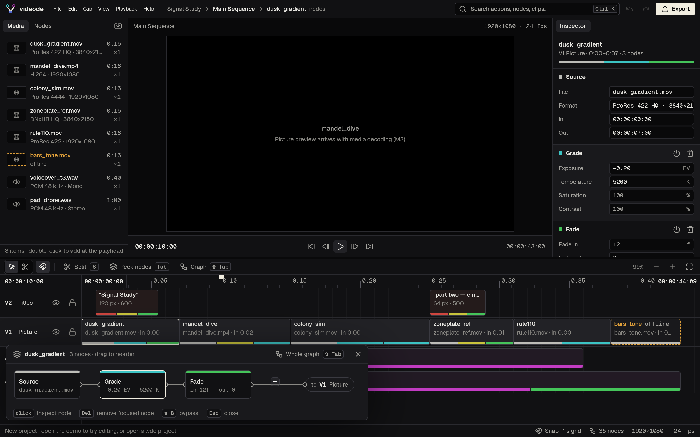
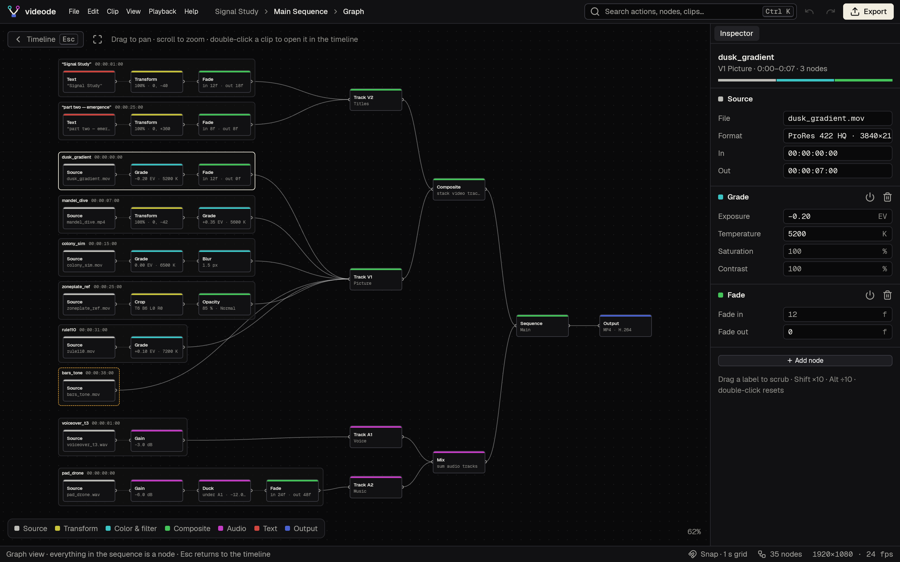

# videode

A native, node-based video editor for Windows, macOS and Linux, written in Rust with [GPUI](https://www.gpui.rs/).

Inside, everything is a node: media, clips, effects, tracks, the sequence and the export. Outside, it is a familiar editor (media bin, viewer, inspector, timeline). Press **Tab** on a clip to peek at its nodes, or **Shift+Tab** to see the whole sequence as a graph.

- Interactive UI mockup: [`mockup/videode.html`](mockup/videode.html)
- Product context: [`PRODUCT.md`](PRODUCT.md) · Design system: [`DESIGN.md`](DESIGN.md) · Plan: [`docs/PLAN.md`](docs/PLAN.md)

## Status

Milestone M2: the node views. Every clip is a chain of nodes you can see and edit:

- **Inspector:** every value is editable. Click to type, drag the label to scrub (Shift ×10, Alt ÷10, double-click resets), ↑/↓ to step. Bypass, remove and add nodes. Export opens the Output node.
- **Peek (Tab):** the selected clip's nodes unfold under it; drag to reorder, + to add, Del removes, ⇧B bypasses.
- **Graph (⇧Tab):** the whole sequence as one graph: clips → tracks → Composite/Mix → Sequence → Output. Drag to pan, scroll to zoom, double-click a clip to open it in the timeline.
- **Command palette (Ctrl/Cmd K):** fuzzy search over actions, nodes, clips and media; A opens it on "Add".

M1's timeline editing (move, trim, split, blade, ripple delete, snapping, zoom, undo/redo, `.vde` KDL files) is all still there. File → Open demo project loads a sample sequence. Picture, sound and export arrive in M3–M5.




## Build

Requires a recent stable Rust toolchain.

```sh
cargo run -p videode-app            # opens the editor
cargo run -p videode-app --example snapshot -- out.png 1440 900        # offscreen screenshot
cargo run -p videode-app --example snapshot -- out.png 1440 900 demo   # same, demo project
                                                                      # (also: settings, about, splash@0.4,
                                                                      #  peek, graph, output, focus, edit, palette=<q>)
./scripts/brand.sh                     # regenerate icons from assets/brand/*.svg
./packaging/linux/install.sh           # install binary, launcher and icons to ~/.local
```

Linux needs the usual GPUI system libraries (Debian/Ubuntu):

```sh
sudo apt install libasound2-dev libfontconfig-dev libwayland-dev libx11-xcb-dev \
  libxkbcommon-x11-dev libssl-dev libzstd-dev libvulkan1
```

## Layout

```
crates/
  videode-core/   project model and node graph engine (no UI)
  videode-app/    the GPUI application: window, theme, editor shell
assets/fonts/     Geist and Geist Mono (SIL OFL 1.1)
mockup/           approved HTML mockup with synthetic demo media
```

## License

MIT or Apache-2.0. Bundled fonts are under the SIL Open Font License (`assets/fonts/OFL-Geist.txt`); icons are Lucide (ISC), via GPUI Kit.
