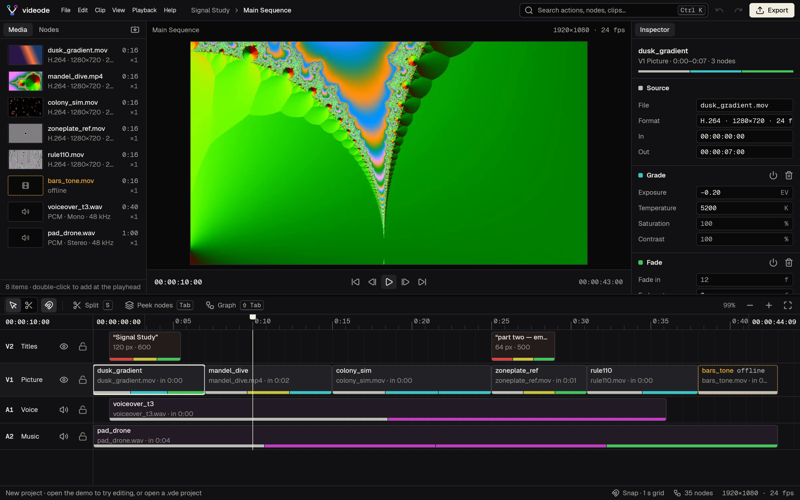

# videode

A native, node-based video editor for Windows, macOS and Linux, written in Rust with [GPUI](https://www.gpui.rs/).

Inside, everything is a node: media, clips, effects, tracks, the sequence and the export. Outside, it is a familiar editor (media bin, viewer, inspector, timeline). Press **Tab** on a clip to peek at its nodes, or **Shift+Tab** to see the whole sequence as a graph.

- Interactive UI mockup: [`mockup/videode.html`](mockup/videode.html)
- Product context: [`PRODUCT.md`](PRODUCT.md) · Design system: [`DESIGN.md`](DESIGN.md) · Plan: [`docs/PLAN.md`](docs/PLAN.md)

## Status

Milestone M4: playback and sound.

- **Sound:** audio clips play through the default output device, mixed with their Gain and Fade nodes; muted tracks are silent. At normal speed the sound's clock drives the playhead, so picture follows audio. J/K/L shuttle runs silent.
- **Meters:** peak meters beside the viewer, green to −12 dB, yellow to −3 dB, then red.
- **Timeline:** waveforms on audio clips and filmstrips on video clips.
- **Viewer:** Grade, Blur and rotation are drawn (on the CPU for now), along with Transform, Crop, Opacity and Fade.
- **Media:** import by menu, Ctrl/Cmd I or drag and drop; thumbnails; offline files can be relinked, and other missing files in the same folder come along.

From M2: every clip is a chain of nodes. Edit any value in the inspector, peek at a clip's nodes with **Tab**, see the whole sequence as a graph with **Shift+Tab**, and search everything with the command palette (**Ctrl/Cmd K**). From M1: timeline editing, undo/redo and `.vde` project files. Export arrives in M5.



## Build

Requires Rust 1.95 or newer (`rustup update stable`) and FFmpeg (shared libraries plus the `ffmpeg` tool, developed against 9.0), found through `pkg-config`.

```sh
cargo run -p videode-app            # opens the editor
cargo run -p videode-app --example snapshot -- out.png 1440 900        # offscreen screenshot
cargo run -p videode-app --example snapshot -- out.png 1440 900 demo   # same, demo project
                                                                      # (also: settings, about, splash@0.4,
                                                                      #  media, peek, graph, output, focus, edit, palette=<q>)
./scripts/brand.sh                     # regenerate icons from assets/brand/*.svg
./packaging/linux/install.sh           # install binary, launcher and icons to ~/.local
```

macOS:

```sh
brew install ffmpeg pkg-config
```

Linux (Debian/Ubuntu) needs GPUI's system libraries and FFmpeg's development packages:

```sh
sudo apt install libasound2-dev libfontconfig-dev libwayland-dev libx11-xcb-dev \
  libxkbcommon-x11-dev libssl-dev libzstd-dev libvulkan1 pkg-config clang \
  ffmpeg libavcodec-dev libavformat-dev libavutil-dev libswscale-dev \
  libswresample-dev libavfilter-dev libavdevice-dev
```

Windows: download a shared FFmpeg build (for example from [BtbN/FFmpeg-Builds](https://github.com/BtbN/FFmpeg-Builds/releases)), set `FFMPEG_DIR` to it, put its `bin` folder on `PATH`, and install LLVM for `libclang`.

See [CONTRIBUTING.md](CONTRIBUTING.md) for tests and pull requests.

## Layout

```
crates/
  videode-core/   project model and node graph engine (no UI)
  videode-media/  FFmpeg probing, frame-accurate video and sample-accurate audio decoding
  videode-audio/  mixer and output engine (cpal); its sample clock drives playback
  videode-render/ pixel effects: Grade, Blur, rotation
  videode-app/    the GPUI application: window, theme, editor shell
assets/fonts/     Geist and Geist Mono (SIL OFL 1.1)
mockup/           approved HTML mockup with synthetic demo media
```

## License

videode is free software under the [GNU Lesser General Public License v3.0 or later](COPYING.LESSER), which builds on the [GNU GPL v3](COPYING).

FFmpeg is linked dynamically and is not bundled. If you distribute videode with an FFmpeg build that includes GPL components, that distribution as a whole falls under the GPL.

Bundled fonts are under the SIL Open Font License (`assets/fonts/OFL-Geist.txt`); icons are Lucide (ISC), via GPUI Kit.

Found a security problem? See [SECURITY.md](SECURITY.md).
