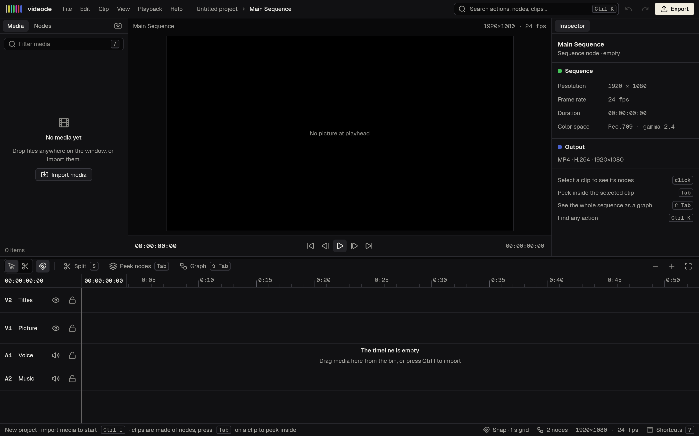

# videode

A native, node-based video editor for Windows, macOS and Linux, written in Rust with [GPUI](https://www.gpui.rs/).

Inside, everything is a node: media, clips, effects, tracks, the sequence and the export. Outside, it is a familiar editor (media bin, viewer, inspector, timeline). Press **Tab** on a clip to peek at its nodes, or **Shift+Tab** to see the whole sequence as a graph.

- Interactive UI mockup: [`mockup/videode.html`](mockup/videode.html)
- Product context: [`PRODUCT.md`](PRODUCT.md) · Design system: [`DESIGN.md`](DESIGN.md) · Plan: [`docs/PLAN.md`](docs/PLAN.md)

## Status

Milestone M0: the editor shell opens with the full panel layout. Editing, playback and export are not implemented yet.



## Build

Requires a recent stable Rust toolchain.

```sh
cargo run -p videode-app            # opens the editor
cargo run -p videode-app --example snapshot -- out.png 1440 900   # offscreen screenshot
```

Linux needs the usual GPUI system libraries (Debian/Ubuntu):

```sh
sudo apt install libasound2-dev libfontconfig-dev libwayland-dev libx11-xcb-dev \
  libxkbcommon-x11-dev libssl-dev libzstd-dev libvulkan1
```

## Layout

```
crates/
  videode-core/   project model and node graph engine (no UI)
  videode-app/    the GPUI application: window, theme, editor shell
assets/fonts/     Geist and Geist Mono (SIL OFL 1.1)
mockup/           approved HTML mockup with synthetic demo media
```

## License

MIT or Apache-2.0. Bundled fonts are under the SIL Open Font License (`assets/fonts/OFL-Geist.txt`); icons are Lucide (ISC), via GPUI Kit.
